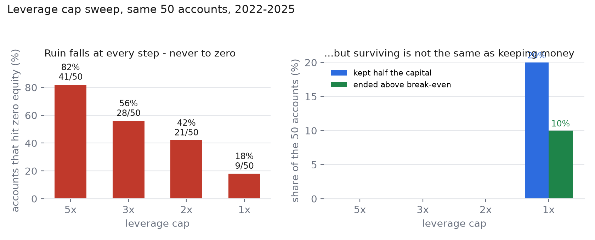

# 研究二：我以为杠杆上限是个旋钮。5x 到 2x 之间，它只是给亏损换了个说法。

*与第一篇相同的 50 个策略 × 市场组合，在四个上限档位上重跑，10 个 Binance 永续合约，每个档位 1700 万次 bar 评估，公开数据可复现。*

**先说结论**

- **爆仓数逐档下降：41 → 28 → 21 → 9（共 50）**，对应上限 5x → 3x → 2x → 1x。看着像个旋钮。
- **经济上它不是旋钮。** 3x 和 2x 下，**没有一个账户保住一半本金**，期末权益中位数是 $0 和 $1。只有 1x 有账户带着钱活下来：**7 个保住一半以上，3 个跑赢本金**。
- **5x 到 2x 之间，平均收益几乎没动**（−100.0% → −99.0%）。变的是标签，不是结果。
- **上限没有拒绝过任何一笔单。** 它是改仓位大小，不是删交易；删交易的是熔断。这个区别比听起来重要。

---

第一篇结尾有句话不太好听：1x 敞口上限做了大部分工作。接下来该问的，也是评论区一定会问的：

*为什么只测 1x？2x、3x 呢？*

这个问题问得对。只测一个档位，没法判断结果是悬崖还是斜坡。所以我把同样 50 个账户在 3x 和 2x 各重跑了一遍，5x 留作对照，1x 那一臂原样复用。

`control` 和 `cap_1x` 就是第一篇的配置，重跑后逐位复现：41/50 与 9/50 爆仓，CVaR −60.9% 与 −9.9%。这是设计里自带的复现校验——这两个数要是动了，说明有 bug，而不是有新发现。

## 扫描结果

| 上限 | 爆仓 | 期末权益中位数 | 保住一半本金 | 跑赢本金 | 下单数 |
|---|---|---|---|---|---|
| 5x（无上限） | **41/50（82%）** | $0 | 0 | 0 | 17,844 |
| 3x | **28/50（56%）** | $0 | 0 | 0 | 44,868 |
| 2x | **21/50（42%）** | $1 | 0 | 0 | 57,985 |
| 1x | **9/50（18%）** | $473 | **7（14%）** | 3（6%） | 65,319 |



只看第二列，是个旋钮。看第三、第四列，就知道它不是。

3x 下有 22 个账户没爆过仓，比 5x 的 9 个好得多。但这 22 个账户全都基本归零——3x 这一臂里期末权益最高的一笔也只有约 $115。**多活下来的账户没有保住钱，只是死得慢一点。** 期末权益中位数：3x 是 0 美元，2x 是 1 美元。

1x 的性质变了：7 个账户保住一半以上本金，3 个跑赢本金，最好的一笔四年 **+126%**。不是因为 1x 有什么魔力，而是因为在 1x 下账户能扛住一次 100% 的不利波动——而四年里，总有一些账户必须扛。

## 没预料到的部分：死掉的账户不再下单

看下单数：5x 是 17,844 笔，1x 是 65,319 笔，**低了杠杆反而多了 3.7 倍**。这不是杠杆效应。

这是存活效应，在成交记录里看得很直接。5x 下账户早早爆仓，然后就没了——剩下三年一笔单都不发。1x 下账户活着，于是全程都在付手续费。策略没有变活跃，是账户没有死。

对用订单量判断系统健康的人，这条有个直接用处：**订单数突然下降，可能是爆仓的第一个症状**，比任何告警都早。所以"这个月我的机器人下单少了"值得去看权益，而不只是看信号。

## 上限不拦单

`cap_blocked` 在所有档位都是 0。上限的实现方式是仓位大小——`min(leverage, cap)`——没有单被拒绝，只是仓位开得更小。

这句话值得明说，因为"敞口上限"听起来像一道拒绝成交的闸门，人们评估它时会默认它有"错过机会"的成本。在这个研究里，它没有这个成本。它不可能错过一笔交易，它只决定每笔交易能占用账户的多大比例。

真正删交易的规则是每日熔断——它会平仓并冻结账户。不同的工具，不同的代价，而第一篇已经显示：阈值和杠杆不匹配时，它可能是有害的。

## 上限对谁有用，取决于策略

按策略拆开的爆仓数，5x → 3x → 2x → 1x：

| 策略 | 5x | 3x | 2x | 1x |
|---|---|---|---|---|
| `donchian` | 4 | 0 | 0 | 0 |
| `ma_trend` | 7 | 2 | 0 | 0 |
| `bollinger_mr` | 10 | 8 | 7 | 1 |
| `random_entry` | 10 | 9 | 5 | 1 |
| `funding_carry` | 10 | 9 | 9 | 7 |

趋势类几乎立刻被救回来：`donchian` 在 3x 就全活，`ma_trend` 在 2x。

`funding_carry` 在任何低于 5x 的档位都救不回来。3x 下九成死，1x 下仍有七成死。这和第一篇的结论一致：1x 下死掉的全是空头——一个跟着资金费率符号翻边的策略，会有很长一段时间在做空，而市场从局部低点涨了 2–33 倍。降低杠杆会推迟这个结果，但改不了下注的方向。

所以"上限设 1x"不是万能药。它对**仓位型**失败模式买来的是存活，对**方向型**失败模式买来的只是延迟。

## 这个研究没有解决什么

先把我能想到的局限列出来，省得读者自己去找。

- **三个档位不是一条曲线。** 我只跑了 5x、3x、2x、1x。1.5x 是否比 1x 保住的更多、2.5x 是否更像 3x，都没有测。我不打算在没跑过的点之间做插值——那不是测过的东西，也不能假装测过。
- **同样的四年、十个币、五个策略。** 单一行情样本。排序也许成立，幅度不会。
- **简化的强平模型**，与第一篇相同：盘中不利极值打到零，没有部分强平、没有 ADL、没有交易所特定的维持保证金。真实结果通常更差。
- **"保住本金"只有一个定义。** 一半本金和回本都是任意阈值。写出来是因为只说"存活"会盖住真正有意思的部分，而不是因为 $5,000 这个数有什么特殊含义。

## 复现

```bash
python run.py download
python run.py validate
python run.py run --configs control,cap_1x,cap_2x,cap_3x --tag leverage
python figures.py
python -X utf8 check_numbers.py
```

杠杆那一臂写进 `results/leverage/`，不碰第一篇的表——`--configs` 不带 `--tag` 会直接拒绝运行，部分矩阵不可能悄悄覆盖已发布的结果。`check_numbers.py` 会从这些 CSV 重算本文的每个数字，包括爆仓数、保本比例，以及 `control` 和 `cap_1x` 是否仍然与第一篇一致。

代码 MIT。数据来自 Binance 公开 API。本文不构成投资建议，四年的模拟也不是预测。

**仓库：** https://github.com/SueroneFelix/perp-guardrails
