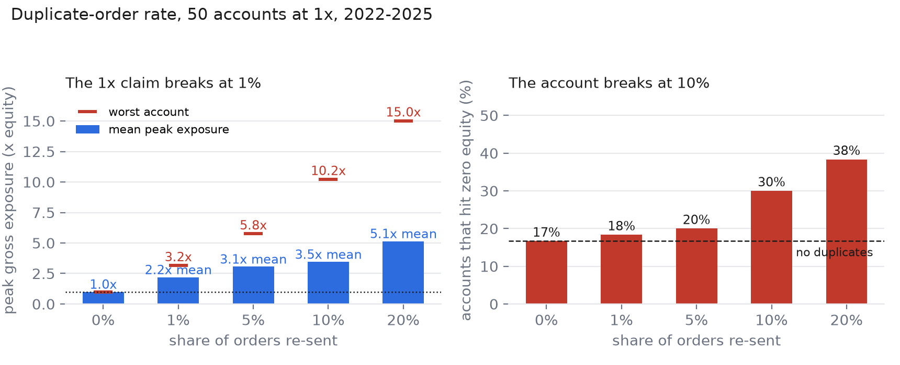

# Study 3: a 1% duplicate order rate already breaks your leverage claim. It takes 10% to break the account.

*Five duplicate rates, the same 50 accounts at 1x on 10 Binance perps, 2022–2025 — 17 million bar evaluations per arm, one parameter changed.*

**TL;DR**

- **At a 1% duplicate rate, all 50 accounts exceeded 2x at some point.** Mean peak exposure 2.4x, worst 3.2x. Ruin barely moved: 18% → 20%.
- **Ruin has a knee at 10%:** 18% → 20% → 22% → **34%** → **44%** as the rate goes 0 → 1% → 5% → 10% → 20%.
- **The survivors pay too.** Median final equity falls from $473 to $46 across the same range, while the strategies and market data are identical.
- **Deduplication does not trade anything away.** At 10% duplication with dedupe on, every published metric is bit-identical to the 0% arm.

---

Study 1 showed that re-sending 10% of orders pushed all 50 accounts above 2x and raised ruin from 18% to 34%. That result had an obvious weakness: **10% was the only rate I tested.** A reader could reasonably conclude that duplication is a switch — either your webhook retries or it doesn't — and that a system with a rare retry is fine.

That is exactly the claim worth testing, because "rare" is what everyone believes about their own system. So I re-ran the same 50 accounts at **0%, 1%, 5%, 10% and 20%**, holding everything else at 1x with no dedupe. One parameter moves.

The answer splits in two, and the split is the interesting part.

## Result 1: the exposure claim fails at 1%



| Re-sent orders | Ruined | Mean peak exposure | Worst account | Duplicates executed | Median final equity |
|---|---|---|---|---|---|
| 0% | 9/50 (18%) | 1.00x | 1.00x | 0 | $473 |
| 1% | 10/50 (20%) | **2.43x** | **3.16x** | 591 | $403 |
| 5% | 11/50 (22%) | 3.47x | 5.75x | 3,203 | $337 |
| 10% | 17/50 (34%) | 3.94x | 10.2x | 6,018 | $246 |
| 20% | 22/50 (44%) | 5.98x | 15.0x | 12,235 | $46 |

At 1%, an account running "1x" spent part of its life at 2.4x on average, and one reached 3.2x. **All fifty accounts broke the 1x claim.** Not most of them. All of them.

This is the part that a binary monitor cannot see. "Did any account exceed 2x?" saturates immediately — it is 50/50 at every nonzero rate in the table, so it cannot distinguish a 1% retry from a 20% retry. If your risk report answers only yes/no questions, it will tell you the same thing about a nuisance and about a pathology.

The magnitude is what carries information, and it moves a long way: worst-case peak exposure goes 1.0x → 3.2x → 5.8x → 10.2x → 15.0x.

## Result 2: the account fails at 10%, not at 1%

Ruin stays close to baseline up to 5% (18% → 20% → 22%) and then more than doubles: 34% at 10%, 44% at 20%.

Why the knee? A duplicated order at 1x doubles the position to 2x, which is survivable unless the market moves hard in the next few hours. At low rates, most duplicates land in quiet stretches. As the rate rises, duplicates start landing *during* the moves that matter — and a 2x position into a 20% adverse move is 40% of the account gone, which is where the compounding stops being recoverable.

I would not claim the knee sits at exactly 10% in general. Five points on a curve is enough to see the shape, not to locate a threshold. What the data supports is narrower and still useful: **the relationship is not linear, and the low-rate end is not a safe zone — it is a zone where the damage is invisible to your P&L and already visible in your exposure.**

## Result 3: the survivors are not fine either

Median final equity across the same 50 accounts: $473 → $403 → $337 → $246 → $46.

These are the accounts that did *not* blow up. They are being slowly taxed. A duplicated order doubles a position, pays double fees and double slippage on the extra side, and then has to be unwound. With 12,235 duplicates executed in the 20% arm, that is a lot of unnecessary round trips at 7 bps a side.

The strategy signals are byte-identical across arms. Everything that separates $473 from $46 is plumbing.

## Result 4: dedupe restores the baseline exactly

The dedupe arm at 10% duplication is **bit-identical** to the 0% arm on every published metric: 9 ruined, 18% ruin rate, 1.001x mean peak exposure, $473 median, −78.2% mean return, 65,319 orders.

Not "close to". Identical. `check_numbers.py` asserts it, and it is the cleanest evidence in the whole study that these are two states of the same system, not two trade-offs. There is no return you give up for correctness here: blocking a replay means the replay never happened.

This is why I keep arguing that idempotency is not a knob to tune. You cannot pick a "duplicate budget" the way you pick a leverage cap, because the cost of a duplicate is not proportional to its rate — it is proportional to what the market does in the next four hours.

## Which strategies get hurt

| Strategy | 0% | 1% | 5% | 10% | 20% |
|---|---|---|---|---|---|
| `donchian` | 0 | 0 | 0 | 0 | 0 |
| `ma_trend` | 0 | 0 | 0 | 1 | 3 |
| `bollinger_mr` | 1 | 2 | 2 | 2 | 5 |
| `funding_carry` | 7 | 7 | 7 | 7 | 7 |
| `random_entry` | 1 | 1 | 2 | 7 | 7 |

Two patterns worth noting. `donchian` never dies in any arm — it trades rarely and its stops are far, so duplication has few opportunities. `funding_carry` is flat at 7 in every arm: its failure mode is direction, not sizing, and no amount of order hygiene fixes a bet that was wrong.

`random_entry` is the sharpest: 1 → 1 → 2 → 7 → 7. The strategy with no edge at all is the one where duplication turns a survivable account into a dead one, which makes sense — it has no trend-following luck to offset the doubled cost.

## What this does not establish

- **Duplicates are independent draws, per order.** Real retries are bursty: a network partition or a stuck queue re-sends the same order in a cluster, not at a steady 1%. The same 1% average with bursty arrival is plausibly worse than this model, because the duplicates concentrate in the minutes around a fast move. I have not measured that.
- **One window length.** Dedupe is modelled as a 30-second idempotency window. Whether 5s or 5min changes the picture for strategies that re-enter quickly is untested — and `bollinger_mr` re-enters fast enough that it might.
- **The benchmark is not in this study.** `buy_hold` sends a single order over four years, so its duplicate draw is a single sample rather than a rate; it carries no information here and I left it out rather than report a meaningless zero.
- **Same four years, same ten symbols, same five naive strategies.** One regime. The shape of the curve is the claim; the numbers are not forecasts.

## Reproduce it

```bash
python run.py download
python run.py validate
python run.py run --configs dup_0pct,dup_1pct,dup_5pct,dup_20pct,dup_nodedupe,dup_dedupe --tag dup_rate
python figures.py
python -X utf8 check_numbers.py
```

`dup_0pct` (1x, no duplicate traffic) and `cap_1x` (5x with a 1x exposure cap) are different code paths and produce bit-identical tables — a coincidence worth keeping as a regression test. `check_numbers.py` enforces that, plus every number in this article.

Code: MIT. Data: Binance public API. Not investment advice.

**Repo:** https://github.com/SueroneFelix/perp-guardrails
