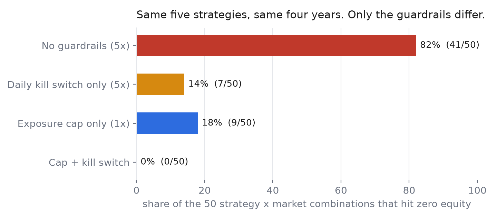
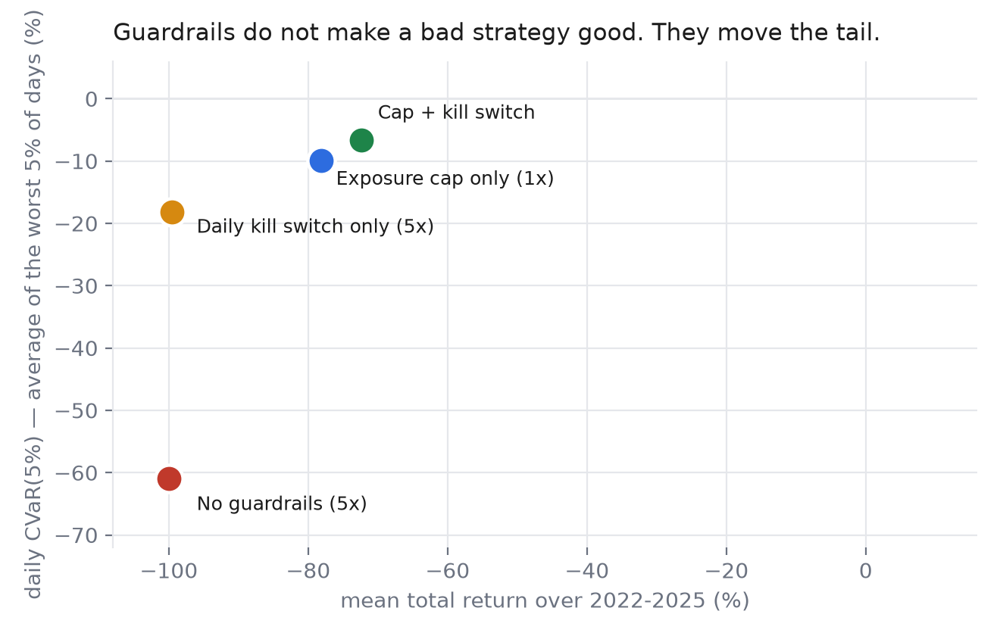
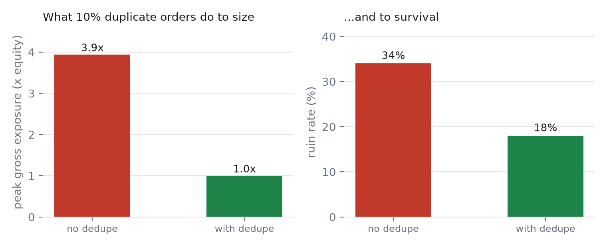

# We ran 50 crypto perpetual strategies through the same four years. The guardrails, not the strategies, decided who survived.

*An ablation study on 1.7 million hourly bars, reproducible from public Binance data in about ten minutes.*

**TL;DR** — Holding five deliberately naive strategies fixed and varying only the guardrails, over 50 strategy × market combinations and four years:

- **No guardrails at 5x: 41 of 50 accounts hit zero.** A 1x exposure cap cut that to 9 of 50. With a daily kill switch on top: **0 of 50**.
- **Tail risk (CVaR 5%) went from −60.9% to −6.7%** of equity per bad day.
- **A daily kill switch on its own, at 5x, made returns worse** — it fired 33,178 times and turned sudden ruin into a slow bleed. The leverage cap does the work; the breaker only catches what the cap can't see.
- **10% duplicate orders took a 1x account to 3.9x exposure** and raised the ruin rate from 18% to 34%. Deduplication is a survival feature, not a nicety.

---

At 3am the position is still open. By 3:07 it isn't — the exchange has closed it for you, at the worst price of the night, and the account is down 40% with no record of why.

Ask anyone who has run a bot on perpetual futures for more than a year and they have a version of this story. The strategy was fine. The *plumbing* wasn't: a webhook fired twice, a stop didn't cancel, leverage was set on the wrong symbol, nobody was watching.

There is a whole industry selling you better strategies. Almost nobody sells you the layer that decides whether the strategy gets to keep playing. So before building anything, I wanted to know one thing:

**If you hold the strategy fixed and change only the guardrails, what happens to the tail?**

Not the average return. The tail. The nights that end accounts.

This is the write-up of that experiment. The code, the data downloader and the result tables are all in the repo; you can reproduce every number below on a laptop with Python 3.13 and no API key.

---

## The setup

**Data.** Binance USDⓈ-M perpetuals, 1-hour bars, 2022-01-01 through 2025-12-31. Ten symbols: BTC, ETH, SOL, BNB, XRP, DOGE, ADA, AVAX, LINK, ARB (ARB from its March 2023 listing). Funding rates applied at their real 8-hour settlement times. No API key, no vendor data, no survivorship picking beyond "these are the pairs people actually trade".

**Costs.** 5 bps taker fee plus 2 bps slippage per side. Market orders only. This is not pessimistic; it is what a retail-sized market order costs on a major pair.

**Execution.** Signals are computed on the bar close and executed at the next bar's open. No same-bar fills, no look-ahead. Position size is set at entry and not rebalanced bar-by-bar.

**Starting capital.** $10,000 per (strategy, symbol) pair, isolated. Fifty pairs, fifty independent accounts per configuration.

**Five strategies plus a benchmark**, deliberately naive and fully public:

1. `ma_trend` — 20/60 moving-average crossover, long/short.
2. `bollinger_mr` — 20-period, 2σ mean reversion, flat outside the band.
3. `donchian` — 20-bar breakout in, 10-bar exit.
4. `funding_carry` — hold the side that collects the trailing 24h funding.
5. `random_entry` — random entries, as a control against luck.

`buy_hold` (always long, one trade) is carried alongside as a benchmark, not counted in the strategy averages.

None of these have an edge. That is the point. I did not want a study where the conclusion depended on my ability to pick a good strategy.

### The configurations

| Config | Leverage | Exposure cap | Daily kill switch |
|---|---|---|---|
| `control` | 5x | — | — |
| `cap_1x` | 5x | 1x | — |
| `kill_5pct` | 5x | — | −5% of day-start equity |
| `all` | 5x | 1x | −5% of day-start equity |

The kill switch flattens the position and freezes the account until the next UTC day. It is a circuit breaker, not a stop-loss.

A second, separate experiment holds leverage at 1x and injects **duplicate orders**: 10% of orders are re-sent within 30 seconds, the way a retrying webhook or a double-firing strategy would. One arm deduplicates them, one doesn't. I kept this out of the main matrix on purpose — a duplicated order at 5x is a different experiment from a duplicated order at 1x, and mixing them contaminated my first run.

**"Ruin"** means equity touched zero and the position was liquidated. Not "had a bad year". Zero.

---

## Result 1: the leverage cap is the only rule that reliably prevents ruin



Across 50 combinations:

- **No guardrails, 5x: 41 of 50 accounts were liquidated.** Mean daily CVaR(5%) was −60.9% — on the worst 5% of days, the average loss was three-fifths of the account.
- **Exposure cap at 1x: 9 of 50 liquidated.** Ruin rate fell from 82% to 18%.
- **Cap plus kill switch: 0 of 50.** No account in that arm ever hit zero.

Zero out of fifty is not proof of safety. It is a sample. But the direction is unambiguous, and it survives every way I sliced it: by strategy, by symbol, and with costs switched off.

The 1x cap is not a clever rule. It is the least interesting guardrail you can install, and it does most of the work. That is worth sitting with, because most retail risk tooling sells complexity — correlation monitors, regime detectors, AI copilots — while the single highest-leverage intervention is "do not let this position be worth more than the account".

## Result 2: a cap alone is not enough, and the survivors explain why



Look at the nine accounts that still died at 1x. Seven of them are `funding_carry` — a strategy that flips with the funding sign, which in practice kept it short 43–62% of the time. In 2023–2025 that meant being short into rallies: every one of those seven symbols eventually ran at least 200% off a local low, and SOL ran 30x. At 1x, a 100% adverse move is still a wipeout. The cap bounds your exposure; it does not bound the market's.

The other two are XRP mean-reversion and XRP random entries — both short when the squeeze came.

Adding the daily kill switch catches exactly this case: seven liquidations in the kill-switch-only arm, zero in the combined arm. The cap stops the common failure; the kill switch stops the one the cap can't see, which is "the market moved further than the cap assumed".

That is also the argument for having both rather than picking a favourite. They fail in different ways.

## Result 3: duplicate orders are not a rounding error



Ten percent duplicate traffic, at 1x, no other rules:

| | No dedupe | Dedupe |
|---|---|---|
| Peak gross exposure | **3.9x** | 1.0x |
| Ruin rate | **34%** | 18% |
| Mean total return | −85.1% | −78.2% |

A single retried webhook doubled the position, repeatedly. The account that was supposed to be running at 1x spent part of its life at nearly 4x, and one in three of those accounts died.

Deduplication is the least glamorous feature in any trading system. It is also the one that decides whether "I'm running at 1x" is a fact or a hope.

---

## The uncomfortable parts

**1. The kill switch on its own made things worse.**

At 5x, a −5% daily equity limit is a ~1% adverse price move. It fired **33,178 times** across the 50 accounts and turned "instant ruin" into "slow bleed": mean return −99.6%, ruin rate 14%. It reduced the number of zeros but destroyed the returns of everything that survived.

This is not an argument against kill switches. It is an argument against installing a kill switch to compensate for leverage you shouldn't be running. At 5x the breaker is triggered by noise, and a rule that fires on noise is a random exit generator. Set the leverage first; the breaker is for the outlier, not for the ordinary Tuesday.

**2. Costs decide whether you make money. Guardrails only decide how you lose.**

The median combination lost more than 90% of its equity even with guardrails on. That is not a bug in the simulation — it is arithmetic. `bollinger_mr` sent 3,001 orders on BTC alone over four years. At 7 bps per side, that is roughly 210% of starting equity paid in fees and slippage, before funding.

I ran the whole matrix again with fees, slippage and funding set to zero, using the same signals. Even gross, `cap_1x` returns −45%, and the uncapped 5x arm still ends at −100%. The strategies have no alpha; the cost structure was never the only problem.

I am publishing this because a study of risk tooling that quietly used a profitable strategy would be worthless. If your strategy has real edge, these numbers tell you what the guardrails cost you in return and what they buy you in survival. If it doesn't, no guardrail will save the P&L — it will only save the account from a single catastrophic night, which is a different and still useful thing.

**3. Even buy-and-hold dies at 5x.**

The benchmark — one trade, no cleverness — was liquidated in **10 out of 10** symbols at 5x over the period. At 1x it survived, ending −26.4% after four years of funding payments: funding alone cost 24–35% of notional on BTC, ETH, XRP, DOGE, ADA, LINK and ARB, while on SOL and BNB it paid longs instead. Leverage, not strategy selection, is the first-order determinant of whether an account exists at the end of the sample.

---

## What this does not prove

I would rather list the holes than have commenters find them.

- **Liquidation is simplified.** I model it as "intrabar adverse extreme took equity to zero". Partial liquidation, insurance funds, ADL and exchange-specific maintenance margins are not modelled. Real liquidations are usually *worse* than this, not better.
- **No order-book depth.** One fixed slippage number for every symbol and every hour. Thin alts are worse than this model says.
- **No operational failures.** Rate limits, rejected orders, disconnects and partial fills are exactly the failure modes a guardrail layer exists for, and none of them are measured here. This study measures policy, not plumbing.
- **One regime, ten symbols, four years.** 2022 was a bear market, 2023–2025 a recovery. Do not extrapolate to a different market structure.
- **No parameter search.** The strategies are fixed at textbook settings. That is deliberate: parameter tuning would turn an ablation into a curve-fit.

The full assumptions list is in the repo README, next to the code that implements them.

---

## Reproduce it

```bash
uv venv
uv pip install -r requirements.txt
source .venv/bin/activate        # Windows: .venv\Scripts\activate
python run.py download           # ~60 MB of public klines and funding, no API key
python run.py validate           # asserts zero gaps in every series
python run.py run                # all 360 strategy/symbol/config runs -> results/*.csv
python run.py run --gross        # same signals, zero fees/funding, as a control
python -m unittest discover -s tests -v
```

Two runs with the same seed produce byte-identical summary CSVs (SHA-256 checked). `results/run_meta.json` records the seed, every cost parameter, the config matrix and the library versions, so a result table can be tied to an exact commit.

The rule semantics used in the simulation are published as a JSON Schema (`rules.schema.json`) — allowed symbols, notional caps, leverage alignment, idempotency windows, kill-switch actions. It is the schema the production sidecar will validate against, so the study doubles as the product's regression fixture.

---

## Why publish numbers where almost everything loses

Because the alternative is another backtest screenshot with a 400% equity curve and no assumptions attached, and the internet has enough of those.

The useful question for anyone running automation is not "what is your Sharpe". It is: *if tonight goes wrong, what stops it from becoming the last night?* That question has an empirical answer, and the answer is boring: cap the exposure, deduplicate the orders, put a breaker on the tail, and don't use leverage that turns noise into a margin call.

That is the layer I'm building — a self-hosted guardrail between your strategy and the exchange. It holds no keys but yours, it defaults to dry-run, and it logs every decision, including the rejections. The research came first because a claim about risk that you can't reproduce is just marketing.

If you run perps with a bot, the repo is the fastest way to check whether my numbers match your experience — and if they don't, I want to know where.

---

*Disclosure: I'm building the guardrail tool described above. The study was designed to be able to falsify the product's core claim, and the negative results (Section "The uncomfortable parts") are reported unedited. Study code: MIT. Data: Binance public API. Nothing here is investment advice; past simulation is not a forecast.*
